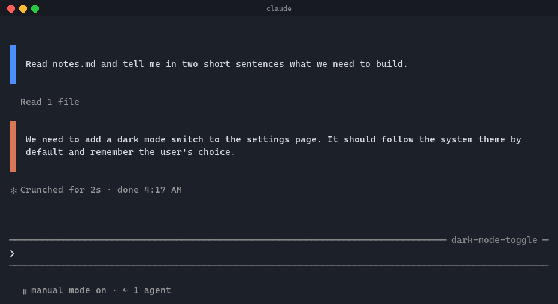

# claude-boxed-messages

[](https://github.com/lucaslobasso/claude-boxed-messages/actions/workflows/ci.yml)
[](LICENSE)
[](#install)

A Claude Code mod that makes long conversations easier to scan. Every message gets a colored box: **blue** for your prompts, **orange** for Claude's replies.

<p align="center">
  
</p>

**[Install](#install) · [How it looks](#how-it-looks) · [Settings](#settings) · [Troubleshooting](#troubleshooting) · [Uninstall](#uninstall)**

## What you get

- A colored bar to the left of every message.
- An optional tinted background behind each message, with dark and light shades.
- Even padding inside each box (1 row top and bottom, 2 columns left and right).
- No `>` marker on your prompts and no `●` bullet on Claude's replies.
- Your own colors, if you want them (see [Settings](#settings)).

Tool rows ("Read 1 file", "Ran command"), summaries and notifications are left as they are. Nothing else changes: the mod doesn't touch your settings, files or prompts.

## Install

**Requirements:** Claude Code with the function-hook plugin API (2.1.3xx or newer; check with `claude --version`). That API is in early access and may change between releases.

At the prompt of a Claude Code session:

```
/plugin install boxed-messages --marketplace lucaslobasso/claude-boxed-messages
```

Answer `y` to add the marketplace, then pick a scope (**user** = every project). Or from a shell:

```
claude plugin install boxed-messages --marketplace lucaslobasso/claude-boxed-messages
```

In the desktop app: click **+** next to the prompt box, then **Plugins**, **Add marketplace** with `lucaslobasso/claude-boxed-messages`, then **Add plugin**.

The boxes appear from the next message on.

### Update

```
claude plugin marketplace update claude-boxed-messages
claude plugin update boxed-messages@claude-boxed-messages
```

Third-party marketplaces don't update automatically unless you turn that on in `/plugin` → **Marketplaces**.

> **Coming from 1.x?** 2.0 no longer includes the status line. On its first start it removes the `statusLine` entry that 1.x added to your `~/.claude/settings.json`, and tells you it did. It only removes an entry that points at this mod's own script. For a similar status line, use [ccstatusline](https://github.com/sirmalloc/ccstatusline). See [CHANGELOG.md](CHANGELOG.md).

## How it looks

**Bars only** (the default):



**With a background** (`/boxed-messages bg`), dark shade: see the picture at the top.

**Light shade** (`/boxed-messages shade`), for light terminal themes:


<sub>The screenshots are real Claude Code output (see [Contributing](#contributing)); the light-shade picture is a drawing that uses the mod's own colors.</sub>

## Settings

Change these in `/config` under **boxed-messages**, or toggle them from the prompt:

| Command | Setting | Default |
| --- | --- | --- |
| `/boxed-messages bars` | Message bars on/off | on |
| `/boxed-messages bg` | Message background on/off | off |
| `/boxed-messages shade` | Background shade: `dark` or `light` (match your terminal theme) | dark |
| `/boxed-messages` | Show the current state | |

Only in `/config`:

| Setting | What it does | Default |
| --- | --- | --- |
| Your color (`userColor`) | Bar color of your prompts, `#rrggbb` | `#4c8dff` |
| Claude's color (`claudeColor`) | Bar color of Claude's replies, `#rrggbb` | `#d97757` |
| Background strength (`tintStrength`) | 0 to 1. Higher is subtler: the background moves further from the bar color toward the theme color | `0.85` |

From a shell you can set them at install time, for example `claude plugin install boxed-messages@claude-boxed-messages --config userColor=#3fb950`.

## Troubleshooting

- **Nothing changed.** Send a new message: boxes are drawn as messages render. Then check that `claude plugin list` shows `boxed-messages` as enabled, and that `claude --version` is 2.1.3xx or newer.
- **A notice says a color "must be a #rrggbb color".** Fix `userColor` or `claudeColor` in `/config`. Until then the mod uses the default color.
- **Double bars.** The mod is loaded twice, for example from the marketplace and from a local folder (`--plugin-dir` or `CLAUDE_CODE_PLUGIN_DIRS`). Keep one.
- **A faint line above messages.** This only happens with the background on, on themes far from a dark blue-grey. See [Known limits](#known-limits).
- **My status line disappeared after updating to 2.0.** That was the 1.x built-in status line, which 2.0 removed. Any other status line is left alone. For a similar one (model, context, git branch, usage), install [ccstatusline](https://github.com/sirmalloc/ccstatusline) (`npx ccstatusline@latest` sets it up), or see [Claude Code's status line docs](https://code.claude.com/docs/en/statusline).

## Uninstall

```
claude plugin uninstall boxed-messages@claude-boxed-messages
claude plugin marketplace remove claude-boxed-messages
```

Nothing is left behind: 2.0 doesn't write any files of its own.

## Known limits

- Your prompts are redrawn as plain text, so special rows (e.g. pasted-image placeholders) show as their text label.
- The background works best on dark themes close to `#1c2029`–`#282c34`; a faint line may show above messages on very different backgrounds.

## Contributing

```
git clone https://github.com/lucaslobasso/claude-boxed-messages
cd claude-boxed-messages
claude --plugin-dir .            # try your changes in a session
claude plugin test .             # tests (tests/*.test.ts)
claude plugin validate .         # manifest and hooks check
```

- Loading the mod once writes its type declarations to `.claude-plugin/types/`, which `tsconfig.json` uses for editor type checking. That folder is git-ignored.
- `node docs/make-images.mjs` redraws the light-shade picture from `hooks/colors.ts` (Node 22.18+). CI checks it is up to date.
- `docs/capture.py` takes the real screenshots offscreen: it runs `claude` in a pseudo-terminal, emulates the screen, and draws it to PNG. Run `python docs/capture.py --help` for details. It needs `pip install pyte pillow pywinpty`.

## License

[MIT](LICENSE). This is a community project, not affiliated with Anthropic.
