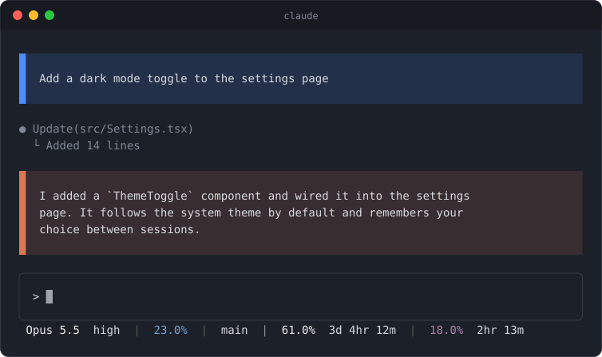
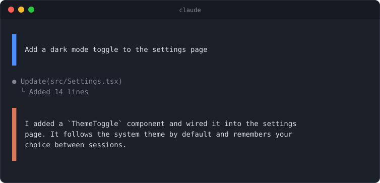
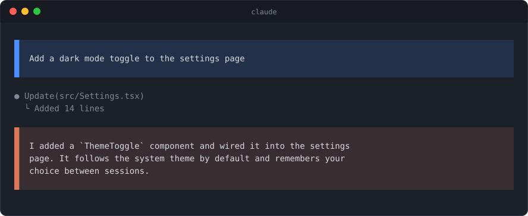
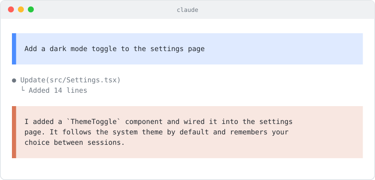
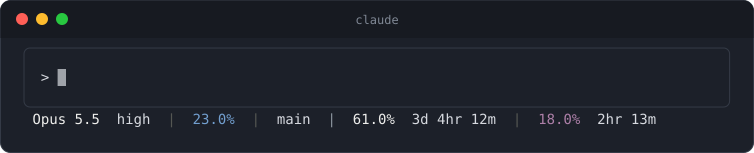

# claude-boxed-messages

[](LICENSE)
[](#install)

A Claude Code mod that makes the conversation easier to scan: every message gets a colored box, and a status line sits under the prompt. Nothing else to install.

<p align="center">
  
</p>
<p align="center"><sub>An illustration, not a screenshot: the real thing uses your terminal's font and theme.</sub></p>

**[Install](#install) · [How it looks](#how-it-looks) · [Settings](#settings) · [Status line](#status-line) · [Troubleshooting](#troubleshooting)**

## What you get

- A colored bar on the left of every message: **blue** for your prompts, **orange** for Claude's replies.
- An optional tinted background behind each message (a dimmed version of its bar color), for dark or light terminals.
- Even padding inside each box (1 row top/bottom, 2 columns left/right).
- No `>` marker on your prompts and no `●` bullet on Claude's replies.
- A built-in status line: model and effort, context used, git branch, and your usage with reset timers.

Tool rows ("Ran command"), summaries and notifications are left as they are.

## Install

At the prompt of a Claude Code terminal session:

```
/plugin install boxed-messages --marketplace lucaslobasso/claude-boxed-messages
```

Answer `y` to add the marketplace, then pick a scope (user scope = every project).

From a shell:

```
claude plugin install boxed-messages --marketplace lucaslobasso/claude-boxed-messages
```

In the desktop app: click **+** next to the prompt box, then **Plugins**, **Add marketplace** with `lucaslobasso/claude-boxed-messages`, then **Add plugin**.

To update later, run `claude plugin update boxed-messages`. To remove it, see [Uninstall](#uninstall).

Requires a Claude Code version with the function-hook plugin API (2.1.3xx). That API is in early access and may change between releases.

## How it looks

**Bars only** (the default):



**With a background** (`/boxed-messages bg`), on a dark terminal:



**Light shade** (`/boxed-messages shade`), for light terminals:



## Settings

In `/config` under `boxed-messages`, or toggle from the prompt:

| Command | Setting | Default |
| --- | --- | --- |
| `/boxed-messages bars` | Message bars on/off | on |
| `/boxed-messages bg` | Message background on/off | off |
| `/boxed-messages shade` | Background shade: `dark` (dark terminals) / `light` (light terminals) | dark |
| `/boxed-messages status` | Built-in status line on/off | on |
| `/boxed-messages` | Show current state | |

Colors and tint strength are constants at the top of `hooks/register.tsx`.

## Status line



From left to right:

| Part | Example | Shows |
| --- | --- | --- |
| Model and effort | `Opus 5.5 high` | The model and its thinking effort |
| Context | `23.0%` | How much of the context window is used |
| Branch | `main` | The git branch (`⎇ no git` outside a repository) |
| Weekly usage | `61.0% 3d 4hr 12m` | Weekly limit used, and time until it resets |
| 5-hour usage | `18.0% 2hr 13m` | Current session limit used, and time until it resets |

Usage comes from the rate-limit data Claude Code provides to the status line, so it appears for Claude subscriptions and is left out otherwise. There is nothing to configure beyond turning it on or off (`/boxed-messages status`, or in `/config`). The layout is a built-in copy of a [ccstatusline](https://github.com/sirmalloc/ccstatusline) setup, so you don't need to install that. Its layout and colors are constants at the top of `statusline/statusline.mjs`.

### How it is wired

Claude Code only reads `statusLine` from the settings files, so the mod keeps a `statusLine` entry in `~/.claude/settings.json` in step with the switch: on adds it, off removes it again. It only ever touches an entry it wrote itself. If you already have a different `statusLine`, the mod leaves it alone and shows a notice; remove yours to use the built-in one. The script runs with `node`, which must be on your `PATH`.

## Troubleshooting

- **No status line.** Restart Claude Code once after installing or turning it on. Then check that `node` is on your `PATH`, and that `~/.claude/settings.json` has a `statusLine` entry containing `statusline/statusline.mjs`. If you see a notice about a different `statusLine`, remove yours.
- **The usage numbers are missing.** They only appear for Claude subscriptions, and only once Claude Code has data to report.
- **A faint line above messages.** Only with the background on, on themes far from a dark blue-grey. See [Known limits](#known-limits).

### Uninstall

Turn the status line off first so the mod removes its settings entry. `/boxed-messages` shows whether it is on, and `/boxed-messages status` flips it. Then uninstall:

```
claude plugin uninstall boxed-messages
```

If you uninstalled without doing that, delete the `statusLine` entry that mentions `statusline/statusline.mjs` from `~/.claude/settings.json`.

## Known limits

- Your prompts are redrawn as plain text, so special rows (e.g. pasted-image placeholders) show as their text label.
- The background works best on dark themes close to `#1c2029`–`#282c34`; a faint line may show above messages on very different backgrounds.
- The usage part of the status line follows the branch, separated by a gray bar, instead of sitting flush right. Claude Code doesn't tell the script the terminal width; if your environment sets `COLUMNS`, the script uses it to right-align.

## Contributing

The pictures above are generated, not hand-drawn: `node docs/make-images.mjs` redraws them from the mod's own colors and the status line script's real output. Run it after changing either.

## License

MIT
