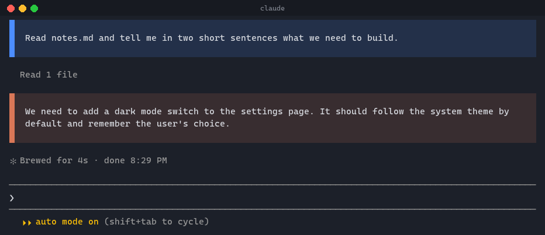
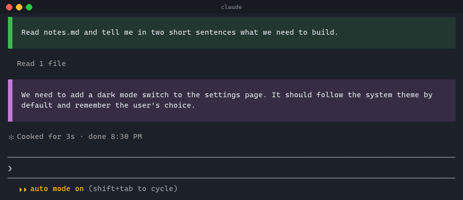
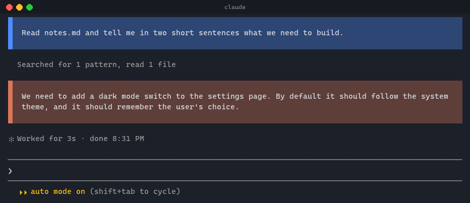
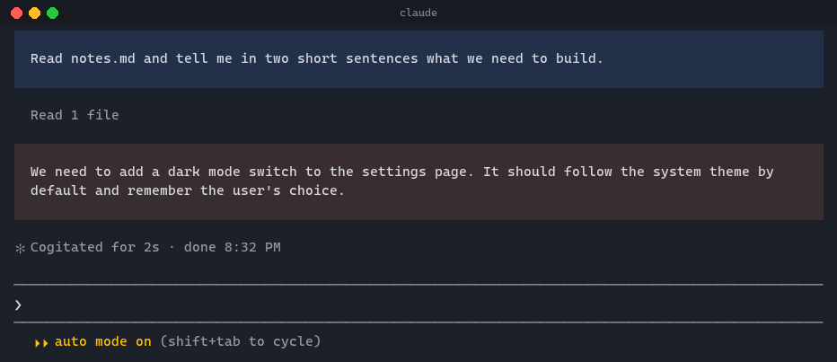
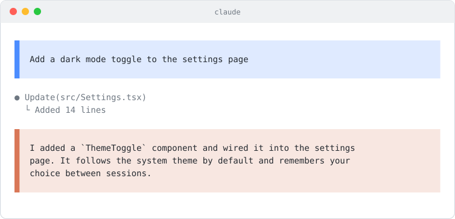

# claude-boxed-messages

[](https://github.com/lucaslobasso/claude-boxed-messages/actions/workflows/ci.yml)
[](CHANGELOG.md)
[](LICENSE)
[](#requirements)
[](#install)

<p align="center">
  
</p>

A Claude Code plugin that makes long conversations easier to scan. Every message gets a colored box: **blue** for your prompts, **orange** for Claude's replies. Colors, background and shade are yours to pick.

> Unofficial community project, not affiliated with Anthropic.

**[Requirements](#requirements) · [Install](#install) · [Settings](#settings) · [How it looks](#how-it-looks) · [Update](#update) · [Troubleshooting](#troubleshooting) · [Uninstall](#uninstall) · [Install the whole set](#install-the-whole-set)**

## Requirements

- Claude Code **2.1.3xx or newer** (`claude --version`), which has the function-hook plugin API. That API is in early access and may change between releases.
- Any OS and terminal with true color (Windows Terminal, iTerm2, most Linux terminals).

## Install

From a shell:

```sh
claude plugin marketplace add lucaslobasso/claude-boxed-messages
claude plugin install boxed-messages@claude-boxed-messages --scope user
```

Or inside a Claude Code session: `/plugin marketplace add lucaslobasso/claude-boxed-messages`, then `/plugin install boxed-messages@claude-boxed-messages`.

In the desktop app: click **+** next to the prompt box, then **Plugins**, **Add marketplace** with `lucaslobasso/claude-boxed-messages`, then **Add plugin**.

The boxes appear from the next message on. You can set options while installing, for example `--config userColor=#3fb950`.

## Settings

Toggle from the prompt, or change any of them in `/config` under **boxed-messages**:

| Setting | Default | Values | Toggle | What it does |
| --- | --- | --- | --- | --- |
| `showBars` | `true` | true / false | `/boxed-messages bars` | Colored bar to the left of every message |
| `showBackground` | `false` | true / false | `/boxed-messages bg` | Tinted background behind each message |
| `backgroundShade` | `dark` | `dark` / `light` | `/boxed-messages shade` | Match your terminal theme |
| `userColor` | `#4c8dff` | `#rrggbb` | `/config` | Color of your prompts |
| `claudeColor` | `#d97757` | `#rrggbb` | `/config` | Color of Claude's replies |
| `tintStrength` | `0.85` | 0 to 1 | `/config` | Higher is subtler: the background moves further from the bar color toward the theme |

`/boxed-messages` on its own shows the current state.

## How it looks

| | |
| --- | --- |
| **Bars only** (default) | **Background on** (`/boxed-messages bg`) |
|  |  |
| **Custom colors** (`userColor=#3fb950`, `claudeColor=#c678dd`) | **Stronger tint** (`tintStrength=0.65`) |
|  |  |
| **Background without bars** (`showBars=false`) | **Light shade** (`/boxed-messages shade`) |
|  |  |

<sub>Screenshots are real Claude Code sessions captured offscreen (see [Contributing](#contributing)). The light-shade picture is a drawing that uses the plugin's own colors.</sub>

Tool rows ("Read 1 file", "Ran command"), summaries and notifications are left as they are. Your prompts lose the `>` marker and Claude's replies lose the `●` bullet; nothing else changes.

## Update

```sh
claude plugin marketplace update claude-boxed-messages
claude plugin update boxed-messages@claude-boxed-messages
```

Third-party marketplaces don't update on their own unless you turn that on in `/plugin` → **Marketplaces**. See [CHANGELOG.md](CHANGELOG.md) for what changed.

## How it works

The plugin hooks Claude Code's message rendering (`ui.render` for `UserMessage` and `AssistantMessage`). Claude's replies are drawn by Claude Code as usual and wrapped in a box; your prompts are redrawn as plain text inside one. Colors come from `hooks/colors.ts`. The plugin writes no files and never touches `settings.json`.

## Troubleshooting

- **Nothing changed.** Send a new message: boxes are drawn as messages render. Check that `claude plugin list` shows `boxed-messages` enabled and `claude --version` is 2.1.3xx or newer.
- **A notice says a color "must be a #rrggbb color".** Fix `userColor` or `claudeColor` in `/config`. Until then the default is used.
- **Double bars.** The plugin is loaded twice, for example from the marketplace and from a local folder (`--plugin-dir` or `CLAUDE_CODE_PLUGIN_DIRS`). Keep one.
- **A faint line above messages.** Only with the background on, on themes far from a dark blue-grey (`#1c2029`–`#282c34`).
- **My status line went away after updating from 1.x.** 1.x shipped a status line; 2.x is boxes only. Install [claude-statusline](https://github.com/lucaslobasso/claude-statusline), which also replaces the leftover 1.x entry.
- **Pasted-image placeholders look like plain text in my prompts.** Your prompts are redrawn as text, so special rows show their text label.

## Uninstall

```sh
claude plugin uninstall boxed-messages@claude-boxed-messages
claude plugin marketplace remove claude-boxed-messages
```

Nothing is left behind.

<!-- bundle:start (copied from claude-launcher/docs/bundle-section.md; edit it there and copy to all six READMEs) -->
## Install the whole set

This is one of six small tools that work well together. Each installs on its own, or get them all with one command:

| Tool | What it does | Runs on |
| --- | --- | --- |
| [Claude Launcher](https://github.com/lucaslobasso/claude-launcher) | One click from the taskbar or Start menu straight into Claude Code, with a Claude icon and a loading spinner | Windows |
| [Claude Taskbar](https://github.com/lucaslobasso/claude-taskbar) | Your Claude sessions and usage limits as dots and bars on the Windows taskbar | Windows |
| [boxed-messages](https://github.com/lucaslobasso/claude-boxed-messages) | Colored boxes around your prompts and Claude's replies | Any |
| [claude-statusline](https://github.com/lucaslobasso/claude-statusline) | A status line with model, context, branch, and usage only when it gets high | Any |
| [limit-revive](https://github.com/lucaslobasso/claude-limit-revive) | Resumes an unfinished session after the usage limit resets | Any |
| [language-spinner](https://github.com/lucaslobasso/claude-language-spinner) | The "thinking" spinner shows words in a language you are learning | Any |

**Windows** (PowerShell 7):

```powershell
irm https://raw.githubusercontent.com/lucaslobasso/claude-launcher/main/bundle.ps1 | iex
```

To pick, pass options: `-Only statusline,limit-revive`, `-Skip launcher`, `-List` (show what is installed) or `-Uninstall`:

```powershell
& ([scriptblock]::Create((irm https://raw.githubusercontent.com/lucaslobasso/claude-launcher/main/bundle.ps1))) -Skip taskbar
```

**macOS and Linux:** the four plugins work everywhere. In a shell:

```sh
for p in boxed-messages statusline limit-revive language-spinner; do
  claude plugin marketplace add "lucaslobasso/claude-$p"
  claude plugin install "$p@claude-$p" --scope user
done
```
<!-- bundle:end -->

## Contributing

```sh
git clone https://github.com/lucaslobasso/claude-boxed-messages
cd claude-boxed-messages
claude --plugin-dir .            # try your changes in a session
claude plugin test .             # tests (tests/*.test.ts)
claude plugin validate .         # manifest and hooks check
```

- Loading the plugin once writes its type declarations to `.claude-plugin/types/` (git-ignored), which `tsconfig.json` uses for editor type checking.
- `python docs/screenshots.py` retakes every screenshot offscreen with `docs/capture.py` (a pseudo-terminal, the pyte emulator and Pillow; no window opens). It needs `pip install pyte pillow pywinpty` and uses your Claude login in a throwaway config folder.
- `node docs/make-images.mjs` redraws the light-shade picture from `hooks/colors.ts` (Node 22.18+). CI checks it is up to date.

## License

[MIT](LICENSE) © Lucas Lobasso
